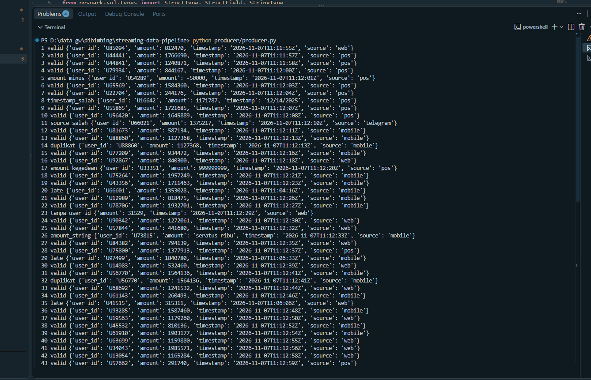
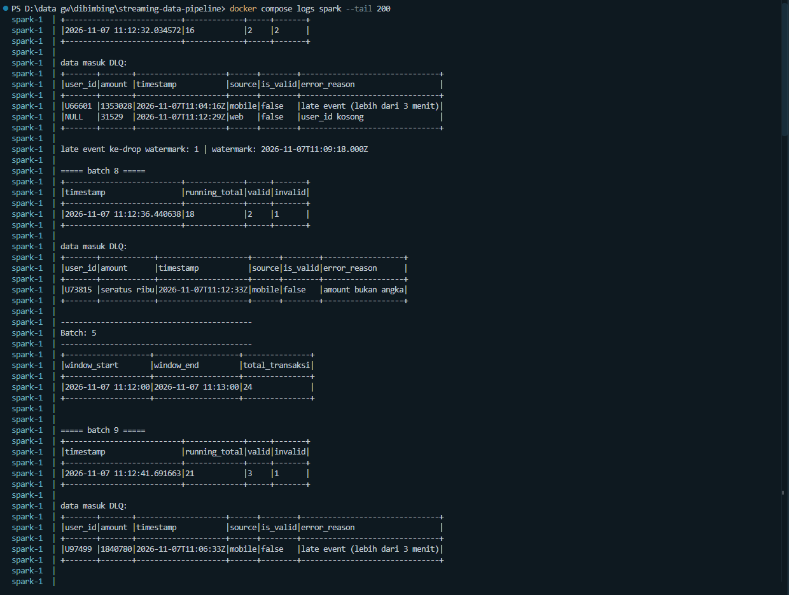

# Streaming for Data Pipeline

Assignment streaming pakai Kafka sama PySpark Structured Streaming.

Alurnya:
producer.py -> topic `transactions` -> spark streaming (validasi) -> `transactions_valid` / `transactions_dlq`

## Isi folder

- `producer/producer.py` : kirim event transaksi ke kafka tiap 1-2 detik
- `streaming/spark_streaming_job.py` : spark streaming buat validasi + routing + window
- `docker-compose.yml` : kafka, kafka-ui, sama spark
- `screenshots/` : bukti screenshot

## Producer

Kirim 60 event ke topic `transactions`. Sebagian sengaja dibikin invalid:

- event 5 : amount minus
- event 8 : format timestamp salah
- event 11 : source "telegram"
- event 14 & 32 : duplikat (user_id + timestamp sama)
- event 17 : amount kegedean
- event 23 : ga ada user_id
- event 26 : amount isinya string
- event 20, 29, 35 : late event (timestamp mundur 5-10 menit)

## Streaming job

Validasi yang dipakai:
1. mandatory field (user_id, amount, timestamp)
2. tipe data (amount harus angka, timestamp harus format ISO)
3. range amount 1 - 10.000.000
4. source harus mobile / web / pos
5. duplikat berdasarkan user_id + timestamp

Hasilnya ditambah kolom `is_valid` sama `error_reason`. Yang valid masuk `transactions_valid`, yang ga valid masuk `transactions_dlq`.

Watermark pakai `withWatermark("event_time", "3 minutes")`. Event yang telat lebih dari 3 menit dari event time terbesar dianggap late dan masuk DLQ juga.

Ada juga tumbling window 1 menit buat ngitung total transaksi per menit. Late event yang lewat watermark bakal di-drop sama spark dan jumlahnya di print.

Output console pakai foreachBatch, isinya kolom `timestamp` (waktu output) sama `running_total` (total transaksi valid).

## Cara jalanin

```
docker compose up -d
docker compose logs -f spark
```

terminal lain:
```
pip install kafka-python
python producer/producer.py
```

Buat liat isi topic bisa buka kafka-ui di http://localhost:8080

## Screenshot

Producer


Output streaming


Topic valid


Topic DLQ

